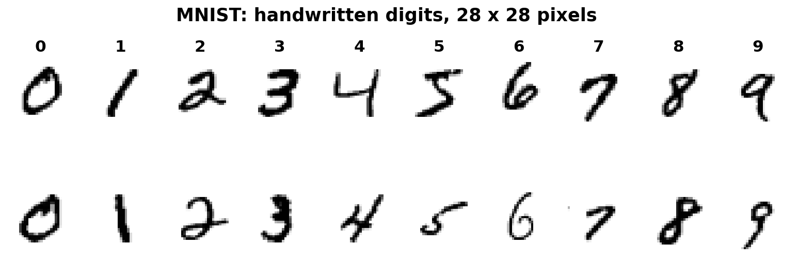
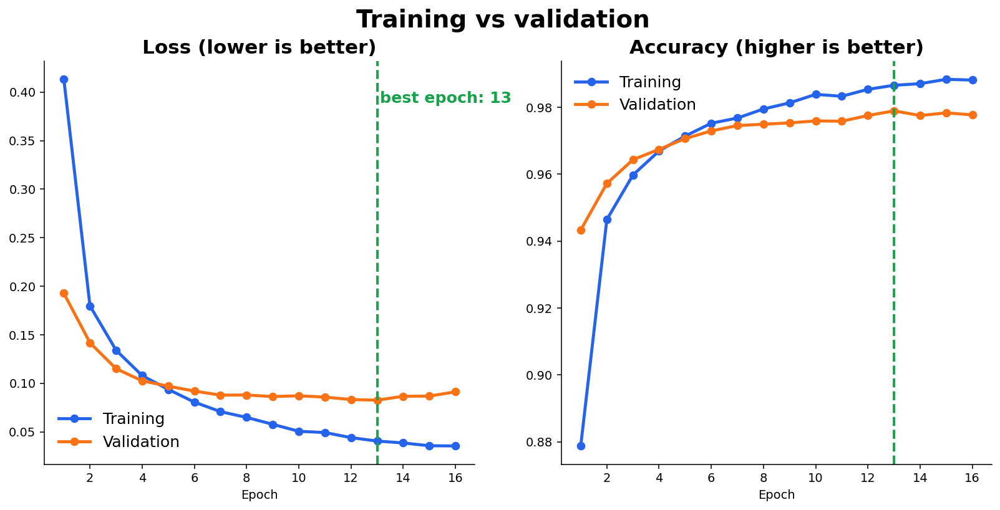
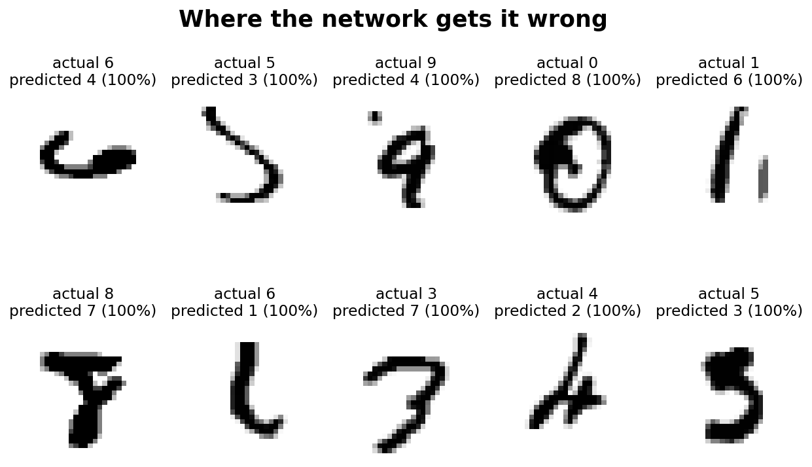
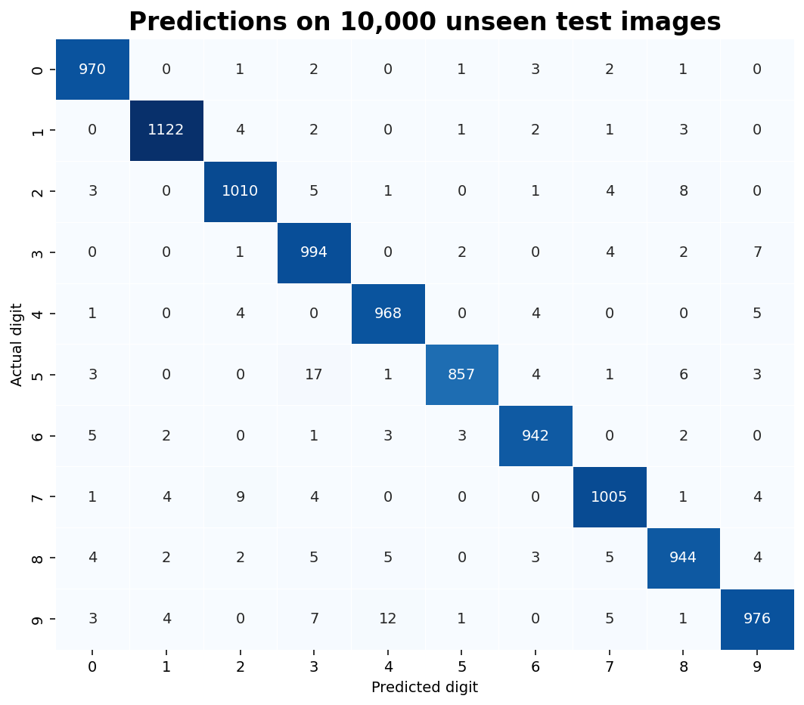

# Neural Network with TensorFlow/Keras: Handwritten Digit Classification

Codveda Technology Machine Learning Internship · Level 3, Task 3

A reproducible pipeline that builds, trains and evaluates a feed-forward neural
network that recognizes handwritten digits (0-9) from the MNIST dataset.

## Dataset

MNIST: 70,000 grayscale images of handwritten digits, 28 x 28 pixels each.
Keras downloads it automatically on the first run.

| Set | Images | Used for |
|---|---|---|
| Train | 50,000 | Learning the weights |
| Validation | 10,000 | Watching for overfitting during training |
| Test | 10,000 | Final evaluation (untouched until step 4) |





## Pipeline

| Step | Script | What it does |
|------|--------|--------------|
| 1 | `01_load_and_preprocess.py` | Loads MNIST, scales pixels to 0-1, makes a stratified validation split |
| 2 | `02_build_model.py` | Designs and compiles the network, draws the architecture |
| 3 | `03_train_model.py` | Trains with backpropagation and early stopping |
| 4 | `04_evaluate_model.py` | Test accuracy, training/validation loss, confusion matrix |

## Architecture

| Layer | Details | Parameters |
|---|---|---|
| Input | 28 x 28 image | 0 |
| Flatten | 784 values | 0 |
| Hidden layer 1 | 128 neurons, ReLU | 100,480 |
| Dropout | 20% of neurons switched off while training | 0 |
| Hidden layer 2 | 64 neurons, ReLU | 8,256 |
| Output layer | 10 neurons, softmax | 650 |

Total: 109,386 trainable parameters.


## Key decisions

- **Pixel scaling.** Pixel values (0-255) are scaled to 0-1, because large
  inputs make training erratic.
- **Stratified validation split.** 10,000 training images are held out, with
  every digit in equal proportion, to watch for overfitting.
- **ReLU hidden layers, softmax output.** Softmax turns the 10 outputs into
  probabilities that sum to 1; the highest one is the prediction.
- **Dropout (20%)** reduces overfitting by stopping the network from relying on
  any single neuron.
- **Adam optimizer and sparse categorical cross-entropy.** Adam updates the
  weights during backpropagation; "sparse" means labels are whole numbers 0-9,
  so no one-hot encoding is needed.
- **Early stopping.** Training stops when validation loss has not improved for
  3 epochs, and the best weights are restored (maximum 20 epochs, batch size
  128).

## Results

| | Accuracy |
|---|---|
| Training (best epoch) | <<TRAIN_ACC>> |
| Validation (best epoch) | <<VAL_ACC>> |
| **Test (10,000 unseen images)** | **<<TEST_ACC>>** |

Test loss: <<TEST_LOSS>>. Training ran for <<EPOCHS_RUN>> epochs; the best
epoch was <<BEST_EPOCH>>.





<<ONE_SENTENCE_ON_WHAT_THE_CURVES_SHOW>>

### Where it goes wrong

Most confused: <<MOST_CONFUSED_PAIR>>. The grid below shows the test images the
network got wrong with the most confidence.








## Limitations

- A feed-forward network flattens each image, so it ignores how nearby pixels
  relate. A convolutional neural network would typically do better on images.
- Results come from a single training run with one random seed.

## Setup and run

```bash
pip install -r requirements.txt
python run_all.py
```

TensorFlow is easiest to run in Google Colab, where it is preinstalled. The
first run needs internet to download MNIST. Training takes a few minutes.
Generated files go to `data/processed/` and `artifacts/` (not tracked in Git);
metrics and the training history go to `outputs/`.

### Run in Google Colab

```python
!git clone https://github.com/nikwesamkelo-max/codveda-ml-task6-neural-network.git
%cd codveda-ml-task6-neural-network
!pip install -q -r requirements.txt
!python run_all.py
```

## Tools

Python, TensorFlow/Keras, NumPy, pandas, scikit-learn, matplotlib, seaborn

## Author

Samkelo · [GitHub](https://github.com/nikwesamkelo-max) ·
[LinkedIn](https://linkedin.com/in/samkelo-nikwe-93226b344)
